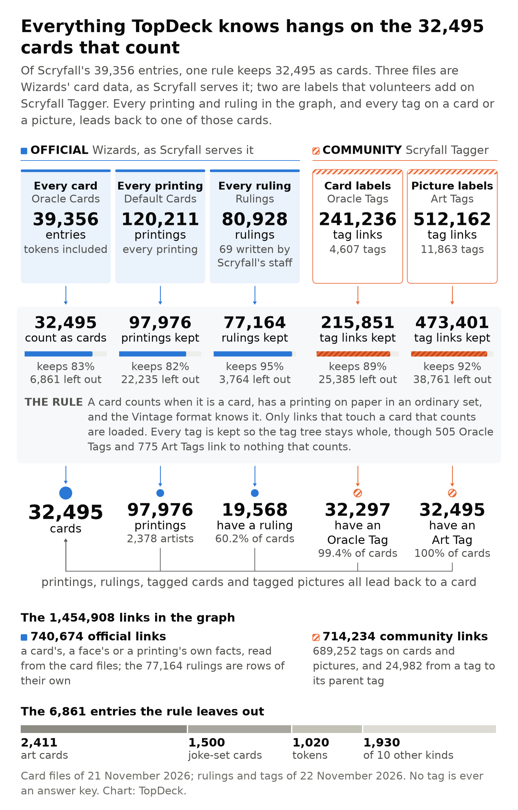
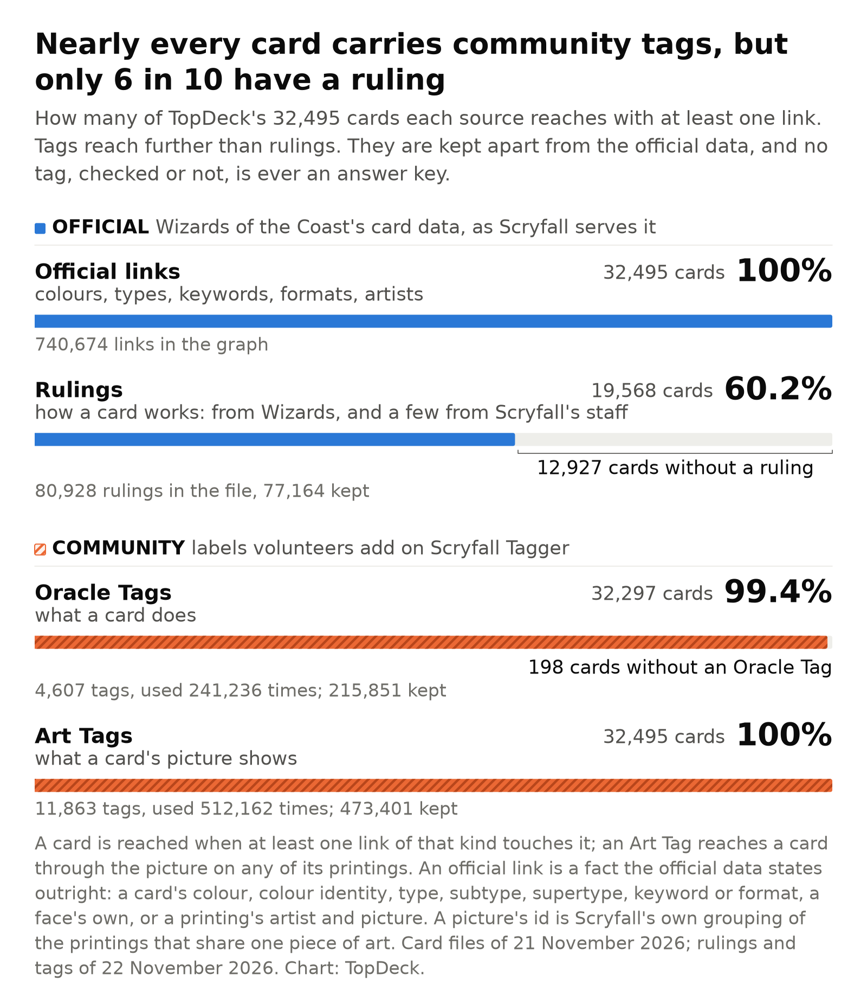

# 🃏 TopDeck

**Questions about Magic: The Gathering cards, answered five ways, with every answer scored by code.**

Most assistants today answer by search: they fetch the few passages that sound most like the question and answer from those. That works for "what does Counterspell do?". It fails for "how many red Goblins cost two mana or less?", because counting needs every matching card, not the five that sound closest.

A knowledge graph stores each fact as a link: this card is red, this card is a Goblin, this card was printed in that set. A query over those links can count, filter and walk from fact to fact.

TopDeck builds both, puts three simpler systems beside them, and measures what each step up buys and what it costs.

I'm building it for two kinds of people:

- **Anyone deciding whether their assistant needs a graph.** The results will show which kinds of question it helps, which it doesn't, and what plain filters already reach.
- **Anyone learning to test AI systems.** Every score here will be rerun by one command.

<picture>
  <source media="(prefers-color-scheme: dark)" srcset="docs/images/what-topdeck-knows-dark.png">
  
</picture>

## 🗺️ Where it stands

TopDeck can't take a free question yet. The cards are counted, the graph is built with the official rulings and the community tags beside it, and the three questions my 2024 notebook asked are [answered](docs/2024-QUESTIONS.md). One job is left in Phase 1: my check of 50 art tags.

| Phase | What it ships | Status |
| --- | --- | --- |
| 0. Ground | The [blueprint](docs/BLUEPRINT.md), tooling, CI, the 2024 code set aside untouched, and [108 questions I chose](questions/chosen.md) before the graph had a layout | 🔨 Under way: the 108 are chosen |
| 1. The cards | The pinned card files, the rule for what counts as a card, the cards in PostgreSQL with every given link, the rulings and the community tags beside them, and my three 2024 questions answered | 🔨 Under way: the graph, the rulings, the tags and the 2024 answers are in; my check of 50 art tags is left |
| 2. The questions | About 540 questions, most with an answer a query can prove | Planned |
| 3. Search | The model alone, search, and search with filters | Planned |
| 4. The graph route | A model that writes read-only queries, inside a fence | Planned |
| 5. Extraction | What cards do, pulled from rules text and scored against my labels | Planned |
| 6. The router | A system that picks a route for each question; the final scores | Planned |
| 7. Serving | An API, a Docker image and a page to ask questions | Planned |
| 8. The telling | The results, written up | Planned |

The [blueprint](docs/BLUEPRINT.md) holds the full plan: the cards, the graph, the questions, the five contenders, how every answer is scored, the cost and the limits.

## 🃏 The cards

Scryfall's file of unique cards holds **39,356** entries, and **32,495** of them count as cards here. The rest are things a player wouldn't call a card, and one Goblin token would change every Goblin count, so the rule comes before any other number.

A card counts when all three of these hold:

1. **It is a card,** not an art card, a token, an emblem, a plane, a scheme or a vanguard.
2. **At least one of its printings is on paper, in an ordinary set.** Every printing is checked, all 120,211 of them.
3. **The Vintage format knows it:** it is legal, restricted or banned there. Vintage allows the most cards of any format, so this leaves out only cards that no format accepts.

| Left out | Why |
| --- | --- |
| 2,411 | An art card |
| 1,500 | Printed only in joke sets |
| 1,020 | A token |
| 742 | Found only in digital Alchemy sets |
| 350 | Printed only as a keepsake |
| 249 | Accepted by no format (a test card, or not yet released) |
| 207 | A plane or phenomenon |
| 107 | A vanguard |
| 102 | A scheme |
| 89 | An emblem |
| 68 | Never printed on paper |
| 13 | Printed only in token sets |
| 3 | Printed only for Planechase |

**The rule I wrote first was wrong, and the data showed it.** Scryfall's file shows one printing of each card, and I judged each card by that printing alone. Where the printing shown was a digital one, the card was dropped: 1,226 real cards, Tolarian Academy among them. The rule now checks every printing, and a test holds it there.

Two more rules cover the awkward shapes:

- **A card with two faces is its front face.** Its own colours, types and power are the front's, and each face keeps its own. A split card is the exception: both halves count. Keywords are the other exception: Scryfall gives them for the whole card, not for each face, so a keyword only the back face has is still linked to the card, and the link says so.
- **Power is a number only when it is a whole one.** Some cards have a power of `*`, so a question about the highest power leaves those out and says so.

The card files are pinned to Scryfall's files of 2026-11-21 by their SHA-256 fingerprints. `uv run topdeck cards count` applies the rule and checks every number above against [`results/cards.json`](results/cards.json).

## 🕸️ The graph

The cards that count, their real printings, the given links the [blueprint](docs/BLUEPRINT.md#the-graph) lists, and the rulings and tags beside them live in PostgreSQL as a graph: one table for each kind of thing, and one table for each kind of link between two things. Some facts Scryfall gives are not loaded yet, because nothing needs them: loyalty, defense, colour indicator, produced mana, flavour text and the artist of each face.

| Things | Rows | | Official links | Rows |
| --- | --- | --- | --- | --- |
| `cards` | 32,495 | | `card_colour` | 33,763 |
| `printings` | 97,976 | | `card_colour_identity` | 36,690 |
| `rulings` | 77,164 | | `card_type` | 34,130 |
| `illustrations` | 49,341 | | `card_subtype` | 34,038 |
| `faces` | 1,694 | | `card_supertype` | 4,456 |
| `artists` | 2,378 | | `card_keyword` | 22,889 |
| `sets` | 626 | | `card_legality` | 372,541 |
| `keywords` | 861 | | `printing_artist` | 97,969 |
| `subtypes` | 470 | | `printing_illustration` | 99,306 |
| `formats` | 23 | | `face_colour` | 1,010 |
| `types` | 10 | | `face_type` | 1,764 |
| `colours` | 5 | | `face_subtype` | 1,784 |
| `supertypes` | 4 | | `face_supertype` | 334 |

| Community things | Rows | | Community links | Rows |
| --- | --- | --- | --- | --- |
| `art_tags` | 11,863 | | `illustration_art_tag` | 473,401 |
| `oracle_tags` | 4,607 | | `card_oracle_tag` | 215,851 |
| | | | `art_tag_parent` | 20,349 |
| | | | `oracle_tag_parent` | 4,633 |

That is **1,454,908 links** in all: 740,674 official and 714,234 from the community. Of the community ones, 689,252 tag a card or a picture, and 24,982 tie a tag to its parent tag. Three things hold:

- **Every link says where it came from:** the Scryfall field it was read from, such as `default_cards.artist`, and how. The official links are *given*, read straight from a field. Rulings are official too, and each links to its card through a column of its own, outside the link count; they are *given*, except the 34 Scryfall's own staff wrote, which say `scryfall`. Tags say `community`. Links pulled out of rules text come in a later phase, marked as such. Two columns are *derived*, worked out after loading rather than read from a field: each card's first printing date, and each set's earliest printing in the graph.
- **Only real printings of cards that count are loaded:** on paper, in an ordinary set. That is why the graph holds 97,976 printings and not all 120,211.
- **Building is safe to repeat.** The graph is loaded beside the live one and swapped in only when the whole load has succeeded. If any step fails, the old graph stands. If anything else has been built on the old graph, the build stops rather than destroy it.

The layout is one file, [`schema.sql`](src/topdeck/sql/schema.sql). `uv run topdeck graph count` counts every table and checks it against [`results/graph.json`](results/graph.json).

## 📚 Rulings and tags

Three more of Scryfall's files, pinned on 2026-11-22, go into the graph in the same build as the cards. They are not the same kind of fact, and the graph keeps them apart.

- **Rulings are official.** Wizards of the Coast writes them to say how a card works. Scryfall's file holds 80,928, and 69 of them were written by Scryfall's own staff; the 34 of those on cards that count are marked as Scryfall's, not Wizards'. The text of a ruling stays in the database and never enters this repo.
- **Oracle Tags and Art Tags come from the community.** Volunteers on Scryfall Tagger label what a card does and what its picture shows. Wizards does not check them, and I have not found how Scryfall reviews them. Every link they make says `community`.

<picture>
  <source media="(prefers-color-scheme: dark)" srcset="docs/images/coverage-dark.png">
  
</picture>

- **How far each reaches.** 19,568 of the 32,495 cards (60.2%) have at least one ruling. 32,297 (99.4%) have an Oracle Tag, and 32,495 (100%) have a picture with an Art Tag on at least one printing.
- **Only links that touch a card that counts are loaded,** and every ruling and link left out is counted with its reason in [`results/graph.json`](results/graph.json): 3,721 rulings for cards that don't count and 43 exact repeats, 25,385 Oracle Tag links on cards that don't count, and 38,761 Art Tag links on pictures that no real printing of a counted card has. Every tag is kept so the tag tree stays whole, though 505 Oracle Tags and 775 Art Tags link to nothing that counts; the record counts those too.
- **Tags never grade themselves.** No tag, checked or not, is ever the answer key for any score. A tag may help a system find cards, and that is all.
- **The art tags wait for my check.** `uv run topdeck tags sample` draws 50 tagged pictures, the same 50 every time: 10 weak, 20 median, 10 strong and 10 very strong, by Tagger's own weights, which seem to say how prominent the thing is in the picture. I will look at each picture on Scryfall and mark its tag right, wrong or can't tell, by [rules I wrote before marking](docs/BLUEPRINT.md#the-graph). `uv run topdeck tags score` then says how often Tagger is right, for each weight and overall, each with its interval. I set the bar before marking: 90% right overall, weighted by how many links of each weight the graph holds. The check measures Tagger; it does not promote any tag. The draw is in [`results/art_tag_sample.json`](results/art_tag_sample.json), without the notes volunteers wrote on some labels.
- **The overall share rests almost wholly on 20 labels.** 97.4% of the art-tag links are median, so the 20 median labels carry nearly all the weight. The overall is worth about 21 labels, its interval is wide, and it clears the bar only if at most 2 of those 20 are wrong. The other weights, 10 labels each, only hint at whether Tagger's weights mean anything.

## 🥊 The contest

Five systems answer the same questions, each one step up from the last, so every gain is measured against something simpler.

| Contender | How it answers |
| --- | --- |
| A. Closed book | The model alone, from memory |
| B. Search | Finds the closest cards by meaning and by keywords, then answers from those |
| C. Search with filters | The model also sets filters on colour, type and cost, and every match comes back |
| D. Graph | The model writes a read-only query over the graph and words the rows that come back |
| E. Router | Plans the steps and picks a route for each |

**The questions I care about most are the ones a web search answers badly.** I rated 132 drafts, and the ones I rated highest need judgement or a story (rules, deck advice, "what happened to"), turn on art and artists with a twist, or ask whether anything odd exists at all. Many can't be answered from card data, so a system earns credit there by saying so, or by citing an official ruling. The [108 I chose](questions/chosen.md) are fixed in the repo before any system runs.

That a database can count and a top-five search can't is known before the first run, so it is not the finding. These are the open questions:

- How often does a model write the right query, and how often is it wrong while sounding sure?
- How much does the wording of a question move the answer?
- How much of the graph's gain can plain filters already reach?
- Does knowledge pulled out of rules text help, or mislead?
- What does each answer cost?

My prediction for each kind of question is [written in the blueprint](docs/BLUEPRINT.md#the-questions) before any run. A wrong one stays in this README.

## 🕰️ 2024 and 2026

I started TopDeck in 2024 as a notebook with three questions. Are Elves green and Goblins red? Do some artists appear far more than others? Which subtypes hide inside which colours? It printed four counts and stopped before answering any of them.

That code and its README are still here, byte for byte, in [`notebooks/2024-original/`](notebooks/2024-original). A test fails if either ever changes. Reading the code again, I found three things this rebuild corrects:

| 2024 | Why it matters | 2026 |
| --- | --- | --- |
| The data file's source isn't recorded | Nobody else can rerun it, me included | A named source, a date and a fingerprint |
| Duplicate names are dropped before artists are counted | If the file holds one row per printing, a card printed five times by five artists keeps one, and the artist counts are wrong | Artists are counted per printing |
| Counts only | A count can't say whether Elves are green more often than creatures in general | Counts with lift (how many times more often than among all the cards compared) and its interval |

The graph now answers all three, on [their own page](docs/2024-QUESTIONS.md), with a chart for each question:

- **Elves are green.** 569 of 669 Elf creatures are green, **3.55 times** as often as creatures in general.
- **Goblins are red.** 453 of 512 are red, **3.83 times** as often as creatures in general.
- **Some artists appear far more than others, and basic lands shape the top of the list.** John Avon has the most printings, 1,216, and 434 of them are basic lands. Leave basic lands out and Kev Walker leads with 1,126, while John Avon ranks 3. Counted the 2024 way, one printing per card, John Avon ranks 18.

Where I began is part of the story.

## 🚀 Try it

You need [uv](https://docs.astral.sh/uv/).

```bash
git clone https://github.com/OGobidike/TopDeck-MTG.git
cd TopDeck-MTG
uv sync --extra figures
uv run pytest
uv run topdeck ground
```

`topdeck ground` checks that the 2024 files are untouched, counts the chosen questions and checks each one is well formed.

To count the cards yourself, fetch the five pinned files: the two card files, the rulings and the two tag files. The first command only says what it would download (131.9 MB, kept packed); the second downloads and checks each file's fingerprint.

```bash
uv run topdeck cards fetch
uv run topdeck cards fetch --yes
uv run topdeck cards count
```

Scryfall replaces its files daily, so the pinned ones may one day no longer be there. If so, the fetch says so and stops. The graph and the 2024 answers need all five files, so they could not be rebuilt either; the recorded results stay in `results/cards.json`, `results/graph.json` and `results/answers_2024.json`, and the charts are drawn from those alone.

To build the graph and answer the 2024 questions, start the database first. You need [Docker](https://docs.docker.com/get-docker/).

```bash
docker compose up -d --wait
uv run topdeck graph build
uv run topdeck graph count
uv run topdeck answers
uv run topdeck tags sample
```

A graph built before the rulings and tags came in must be built again: `graph count`, `answers` and `tags sample` say so, and `graph build` replaces it.

To check the art tags, write the draw as a table, mark the last column of each row `right`, `wrong` or `can't tell`, and score it. The table shows the notes volunteers wrote on some labels, so it goes in `marking/`, which Git ignores. The score records the verdicts in `results/art_tag_verdicts.json`, keyed by picture and tag, with no notes, and `tags score` alone scores them again.

```bash
uv run topdeck tags sample --table marking/art-tags.md
uv run topdeck tags score --table marking/art-tags.md
```

The charts are drawn from the records in `results/` alone, so they need no database, only the optional `figures` extra that the first `uv sync` above installs. A plain `uv sync` takes it away again.

```bash
uv run topdeck figures
```

Each command ends on one plain line that says whether it worked. The database is a local one for development: it listens on this machine only, on port 5544, and holds nothing but public card data. To use another PostgreSQL, set `TOPDECK_DATABASE_URL`. The tests use the same database, and skip their database part when it isn't running; set `TOPDECK_REQUIRE_DB=1` to make that a failure instead, as CI does. Without the `figures` extra the chart tests skip in the same way, and fail where a database is required.

## ✅ Tested

- ✅ **150 tests**, run by CI on every push and pull request
- ✅ **The 2024 files are pinned by their SHA-256 fingerprints.** No formatter may touch them, and Git may not rewrite their line endings; a test covers each
- ✅ **Every rule for a chosen question is tested against the fault it exists to catch**: a missing question mark, a repeat, a gap in the numbering, a fragment
- ✅ **The rule for what counts as a card is tested reason by reason,** on cards I invented, so no real card text sits in the tests
- ✅ **The card count is checked against its record:** one changed number fails the command
- ✅ **A download that isn't the pinned file is refused,** and nothing of it is kept
- ✅ **The graph is tested against a real PostgreSQL,** in CI too, where a missing database fails the run instead of skipping it: the link counts worked out by hand, where every link says it came from, the front-face and split-card rules and the keyword exception, a build that fails even after the old graph was dropped, and a build that stops rather than destroy something built on the graph
- ✅ **The 2024 answers are tested on invented cards,** where the lift and its interval can be worked out by hand. They are checked exactly: nothing in them is random
- ✅ **The rulings and tags are tested on invented ones,** with no real ruling text: each new table, the exact source and method of every link, and the count of everything left out and why
- ✅ **The art-tag draw is tested for coming out the same every time,** label by label against its seeded hash, for keeping to its share of each weight and for keeping volunteers' notes out of the record. The score is tested on invented verdicts: read back from a marked table, refused when a row was edited, with can't-tell left out and the overall's interval worked out by hand
- ✅ **The charts are drawn in the tests from the records alone,** twice, and must come out byte for byte the same, with no text under 12 points, out of the frame or on top of other text. The images in `docs/images` must match them pixel for pixel, so a chart can't fall behind its record. CI installs the `figures` extra so these run there too
- ✅ **No test can reach the internet.** A fixture fails any test that tries, so later phases can't spend money by accident
- ✅ **This README is tested too**: its test count, its phase table, the numbers it takes from the records, the size and number of the pinned files, and every chart it shows, in light and dark, must match the repo, the blueprint and the records. The 2024 answers page is written from its record, never by hand
- ✅ `ruff check` and `ruff format --check` pass

## 🗂️ Repo map

| Path | What it holds |
| --- | --- |
| [`docs/BLUEPRINT.md`](docs/BLUEPRINT.md) | The plan the repo is built against |
| [`questions/chosen.md`](questions/chosen.md) | The 108 questions I chose before the graph had a layout, and why |
| [`src/topdeck/`](src/topdeck) | The package and the `topdeck` command |
| [`docs/2024-QUESTIONS.md`](docs/2024-QUESTIONS.md) | My three 2024 questions, answered |
| [`docs/images/`](docs/images) | The charts, light and dark, drawn by `topdeck figures` from the records |
| [`src/topdeck/sql/schema.sql`](src/topdeck/sql/schema.sql) | The graph's layout |
| [`docker-compose.yml`](docker-compose.yml) | The local database |
| [`results/`](results) | The recorded counts and answers, each reproduced by one command |
| [`tests/`](tests) | The tests, and the invented cards they run on |
| [`notebooks/2024-original/`](notebooks/2024-original) | Where I began, unchanged |

## ⚖️ Limits

- **TopDeck measures a clean, shallow graph of game cards.** It won't prove the same gains on messy company documents.
- **Part of the result is known in advance.** Search with filters is in the contest so the graph gets no credit for what filters already do.
- **Models have read about Magic.** The plan tests for that memory with newer cards and with invented ones; it can't remove it.
- **Every hand label is mine.** I measure how often I agree with myself; nobody else checks me.
- **The tags are only as good as the volunteers who wrote them.** Tagger has tagged nearly every picture, which is why every card has an art tag: the 100% says how busy Tagger is, not how right. Until my check of 50 art tags is done, I don't know how often they are right. Oracle Tags are not checked; they serve only as a second opinion beside my effect labels.

The blueprint lists the rest, and what was still unchecked when the plan was written.

## 🙏 Credits

- **The cards and the rulings** come from [Scryfall](https://scryfall.com)'s free bulk files, and **the tags** from [Scryfall Tagger](https://tagger.scryfall.com), its community project. TopDeck uses card text and facts only, and no card images.
- **The idea** is inspired by Knowledge Augmented Generation ([arXiv 2409.13731](https://arxiv.org/abs/2409.13731)). TopDeck is not a copy of that paper's method.
- **My other projects** it builds on: [The Disease Division](https://github.com/OGobidike/disease-division) for the scoring, and [Morning Manna](https://github.com/OGobidike/Morning-Manna) for the stack.
- I build with an AI pair-programmer, and I review, test and run every change myself.

TopDeck is unofficial Fan Content permitted under the Fan Content Policy. Not approved/endorsed by Wizards. Portions of the materials used are property of Wizards of the Coast. ©Wizards of the Coast LLC.

The code is under the [MIT License](LICENSE).
