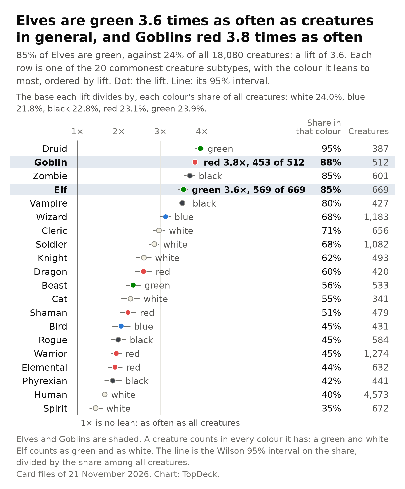
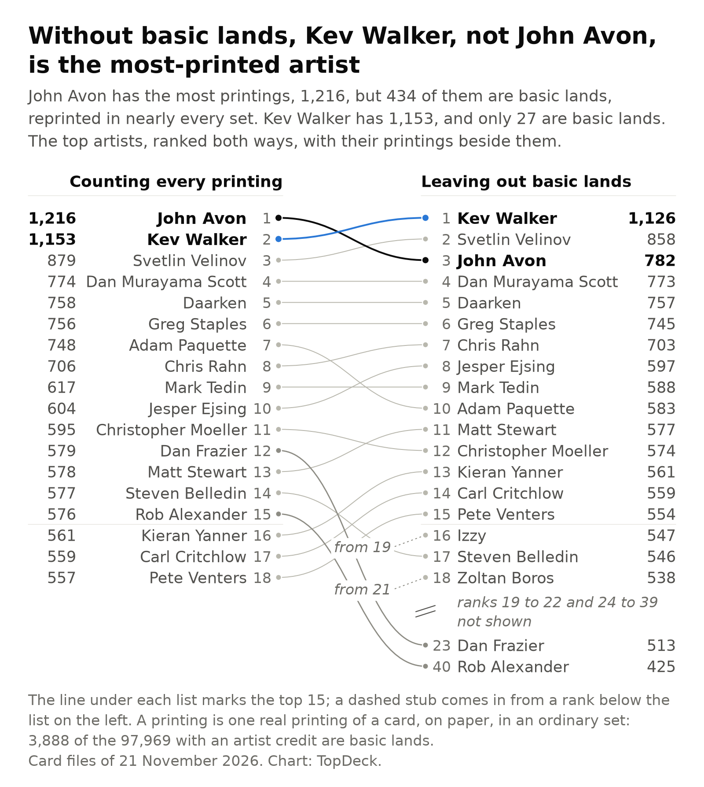
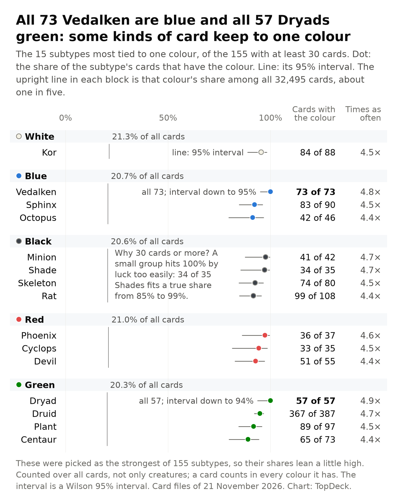

# 🧝 The 2024 questions, answered

In 2024 I started TopDeck as a notebook with three questions about Magic: The Gathering cards. It printed four counts and stopped before answering any of them. This page answers all three from TopDeck's graph, built from Scryfall's card files of 2026-11-21.

`uv run topdeck answers` works every number on this page out again and checks it against [`results/answers_2024.json`](../results/answers_2024.json). `uv run topdeck figures` draws the charts from the same record.

## 📏 How to read the numbers

- **What counts as a card.** 32,495 cards count here; the [README](../README.md#-the-cards) gives the rule and what it leaves out.
- **A card is its front face.** A card with two faces is counted by the colours and types of its front. A split card is both halves.
- **"Green" means green is among the card's colours.** A green and white Elf counts as green, and as white.

### Words used here

| Word | What it means |
| --- | --- |
| Printing | One real printing of a card: on paper, in an ordinary set. Promos, Secret Lair-style box sets, masterpieces and basic lands all count. A card printed in five sets has five printings |
| Subtype | The words after the dash on a card's type line, such as Elf or Goblin. Not every subtype is a creature kind: Aura, Saga and Equipment are subtypes too |
| Share | Of the cards in a group, the part that has a colour |
| Lift | A group's share divided by the share among all the cards compared. A lift of 3 means the colour turns up three times as often in the group |
| 95% interval | The range in brackets. A share's is a Wilson interval. A lift's is the share's interval divided by the share among all the cards compared; that base is measured over thousands of cards, so its own uncertainty is small and left out |

## 1. Are Elves green and Goblins red?

**Yes, both, and strongly.**

- **569 of 669** Elf creatures are green: 85.1% (82.2% to 87.6%). Of all 18,080 creatures, 23.9% are green, so the lift is **3.55** (3.43 to 3.66).
- **453 of 512** Goblin creatures are red: 88.5% (85.4% to 91.0%). Of all creatures, 23.1% are red, so the lift is **3.83** (3.70 to 3.94).

Here are the 20 commonest creature subtypes, each with the colour it is most tied to, ordered by lift as in the chart. The lift compares each with all the creatures.

<picture>
  <source media="(prefers-color-scheme: dark)" srcset="images/lift-by-subtype-dark.png">
  
</picture>

| Subtype | Creatures | Colour | Share | Lift |
| --- | --- | --- | --- | --- |
| Druid | 387 | Green | 94.8% | 3.96 (3.85 to 4.04) |
| Goblin | 512 | Red | 88.5% | 3.83 (3.70 to 3.94) |
| Zombie | 601 | Black | 84.5% | 3.71 (3.57 to 3.83) |
| Elf | 669 | Green | 85.1% | 3.55 (3.43 to 3.66) |
| Vampire | 427 | Black | 80.3% | 3.52 (3.35 to 3.68) |
| Wizard | 1,183 | Blue | 68.1% | 3.12 (3.00 to 3.24) |
| Cleric | 656 | White | 71.0% | 2.97 (2.82 to 3.10) |
| Soldier | 1,082 | White | 68.3% | 2.85 (2.73 to 2.96) |
| Knight | 493 | White | 62.3% | 2.60 (2.42 to 2.77) |
| Dragon | 420 | Red | 59.8% | 2.59 (2.38 to 2.79) |
| Beast | 533 | Green | 56.1% | 2.34 (2.17 to 2.52) |
| Cat | 341 | White | 54.5% | 2.28 (2.06 to 2.49) |
| Shaman | 479 | Red | 51.1% | 2.22 (2.02 to 2.41) |
| Bird | 431 | Blue | 44.8% | 2.05 (1.84 to 2.27) |
| Rogue | 584 | Black | 45.2% | 1.98 (1.81 to 2.16) |
| Warrior | 1,274 | Red | 44.7% | 1.94 (1.82 to 2.06) |
| Elemental | 632 | Red | 44.0% | 1.91 (1.74 to 2.07) |
| Phyrexian | 441 | Black | 42.2% | 1.85 (1.65 to 2.05) |
| Human | 4,573 | White | 39.6% | 1.65 (1.60 to 1.71) |
| Spirit | 672 | White | 34.5% | 1.44 (1.30 to 1.59) |

The tightest tie in the table is Druid to green (lift 3.96). The loosest is Spirit to white (lift 1.44).

## 2. Do some artists appear far more than others?

**Yes.** 2,378 artists are credited on 97,969 printings. Half of them have 7 printings or fewer, while the top 1% (24 artists) hold **16.3%** of all printings.

**Basic lands shape the top of this list.** John Avon has the most printings, 1,216, and 434 of them are basic lands. Leave basic lands out and Kev Walker leads with 1,126, while John Avon ranks 3. Counted the 2024 way, one printing per card, John Avon ranks 18. Of all 97,969 printings, 3,888 are basic lands, reprinted in nearly every set, so an artist who painted many of them climbs the count quickly.

<picture>
  <source media="(prefers-color-scheme: dark)" srcset="images/artists-basic-lands-dark.png">
  
</picture>

| Artist | Printings | Of them basic lands | Different cards | Rank without basic lands | Rank the 2024 way |
| --- | --- | --- | --- | --- | --- |
| John Avon | 1,216 | 434 | 222 | 3 | 18 |
| Kev Walker | 1,153 | 27 | 466 | 1 | 1 |
| Svetlin Velinov | 879 | 21 | 369 | 2 | 2 |
| Dan Murayama Scott | 774 | 1 | 304 | 4 | 3 |
| Daarken | 758 | 1 | 307 | 5 | 5 |
| Greg Staples | 756 | 11 | 330 | 6 | 4 |
| Adam Paquette | 748 | 165 | 182 | 10 | 65 |
| Chris Rahn | 706 | 3 | 243 | 7 | 12 |
| Mark Tedin | 617 | 29 | 207 | 9 | 19 |
| Jesper Ejsing | 604 | 7 | 234 | 8 | 16 |
| Christopher Moeller | 595 | 21 | 256 | 12 | 7 |
| Dan Frazier | 579 | 66 | 178 | 23 | 38 |
| Matt Stewart | 578 | 1 | 253 | 11 | 8 |
| Steven Belledin | 577 | 31 | 184 | 17 | 39 |
| Rob Alexander | 576 | 151 | 155 | 40 | 54 |

With basic lands left out, 94,081 printings remain, and the list starts like this:

| Artist | Printings, no basic lands | Different cards | Rank with basic lands |
| --- | --- | --- | --- |
| Kev Walker | 1,126 | 461 | 2 |
| Svetlin Velinov | 858 | 364 | 3 |
| John Avon | 782 | 217 | 1 |
| Dan Murayama Scott | 773 | 303 | 4 |
| Daarken | 757 | 306 | 5 |
| Greg Staples | 745 | 328 | 6 |
| Chris Rahn | 703 | 241 | 8 |
| Jesper Ejsing | 597 | 229 | 10 |
| Mark Tedin | 588 | 202 | 9 |
| Adam Paquette | 583 | 172 | 7 |
| Matt Stewart | 577 | 252 | 13 |
| Christopher Moeller | 574 | 251 | 11 |
| Kieran Yanner | 561 | 251 | 16 |
| Carl Critchlow | 559 | 228 | 17 |
| Pete Venters | 554 | 293 | 18 |

**The 2024 way.** My notebook dropped duplicate card names before it counted artists, which keeps one printing of each card. I replay that here by keeping each card's earliest real printing. Counted that way, Kev Walker leads with 370 cards. An artist whose work is reprinted often, basic lands most of all, falls down this list, because every reprint after the first is dropped.

| Artist, the 2024 way | Cards, one printing each | Rank by printings |
| --- | --- | --- |
| Kev Walker | 370 | 2 |
| Svetlin Velinov | 294 | 3 |
| Dan Murayama Scott | 268 | 4 |
| Greg Staples | 262 | 6 |
| Daarken | 255 | 5 |
| Pete Venters | 252 | 18 |
| Christopher Moeller | 219 | 11 |
| Matt Stewart | 217 | 13 |
| Ron Spencer | 205 | 31 |
| Zoltan Boros | 205 | 21 |
| Kieran Yanner | 202 | 16 |
| Chris Rahn | 201 | 8 |
| Steve Prescott | 197 | 28 |
| Izzy | 190 | 19 |
| Carl Critchlow | 186 | 17 |

An artist is counted as credited on the card, so two artists who share a credit are counted as one name.

## 3. Which subtypes hide inside which colours?

Of the 155 subtypes with at least 30 cards, these 15 are tied most strongly to one colour. This chart and table compare against all 32,495 cards, not only creatures, so their subtypes include kinds that aren't creatures, such as Auras and Sagas.

<picture>
  <source media="(prefers-color-scheme: dark)" srcset="images/subtypes-by-colour-dark.png">
  
</picture>

| Subtype | Cards | Colour | Share | Lift |
| --- | --- | --- | --- | --- |
| Dryad | 57 | Green | 100.0% (93.7% to 100.0%) | 4.93 (4.62 to 4.93) |
| Vedalken | 73 | Blue | 100.0% (95.0% to 100.0%) | 4.83 (4.58 to 4.83) |
| Minion | 42 | Black | 97.6% (87.7% to 99.6%) | 4.73 (4.25 to 4.82) |
| Shade | 35 | Black | 97.1% (85.5% to 99.5%) | 4.71 (4.14 to 4.82) |
| Druid | 387 | Green | 94.8% (92.2% to 96.6%) | 4.67 (4.54 to 4.76) |
| Phoenix | 37 | Red | 97.3% (86.2% to 99.5%) | 4.64 (4.11 to 4.74) |
| Plant | 97 | Green | 91.8% (84.6% to 95.8%) | 4.52 (4.17 to 4.72) |
| Cyclops | 35 | Red | 94.3% (81.4% to 98.4%) | 4.49 (3.88 to 4.69) |
| Kor | 88 | White | 95.5% (88.9% to 98.2%) | 4.49 (4.18 to 4.62) |
| Skeleton | 80 | Black | 92.5% (84.6% to 96.5%) | 4.48 (4.10 to 4.68) |
| Sphinx | 90 | Blue | 92.2% (84.8% to 96.2%) | 4.45 (4.09 to 4.64) |
| Rat | 108 | Black | 91.7% (84.9% to 95.6%) | 4.44 (4.11 to 4.63) |
| Devil | 55 | Red | 92.7% (82.7% to 97.1%) | 4.42 (3.94 to 4.63) |
| Octopus | 46 | Blue | 91.3% (79.7% to 96.6%) | 4.41 (3.84 to 4.66) |
| Centaur | 73 | Green | 89.0% (79.8% to 94.3%) | 4.39 (3.93 to 4.65) |

These rows were picked for being the strongest, so their lifts lean a little high: the luckiest of many pairs always looks better than it is.

At the other end, these subtypes are spread most evenly over the five colours. This table counts one-coloured cards only, so each card counts once and a row's shares add up to 100%. Of the subtypes with at least 30 one-coloured cards (127), these are the most even. An evenness of 1 is a perfectly even spread.

| Subtype | One-coloured cards | Evenness | White | Blue | Black | Red | Green |
| --- | --- | --- | --- | --- | --- | --- | --- |
| Spellshaper | 54 | 1.000 | 18.5% | 20.4% | 20.4% | 20.4% | 20.4% |
| Saga | 168 | 0.994 | 25.0% | 17.3% | 17.9% | 20.2% | 19.6% |
| Sliver | 89 | 0.994 | 22.5% | 16.9% | 16.9% | 23.6% | 20.2% |
| Horse | 42 | 0.991 | 21.4% | 19.0% | 23.8% | 14.3% | 21.4% |
| Lesson | 60 | 0.989 | 16.7% | 23.3% | 15.0% | 20.0% | 25.0% |
| Avatar | 96 | 0.985 | 22.9% | 16.7% | 21.9% | 13.5% | 25.0% |
| Aura | 1,162 | 0.984 | 23.4% | 27.1% | 18.1% | 14.3% | 17.1% |
| Arcane | 95 | 0.982 | 15.8% | 25.3% | 20.0% | 25.3% | 13.7% |
| Wall | 127 | 0.981 | 26.0% | 26.0% | 15.7% | 17.3% | 15.0% |
| God | 56 | 0.979 | 17.9% | 19.6% | 17.9% | 30.4% | 14.3% |

## ⚖️ Limits

- These are counts of cards printed, not of cards played. A colour's share says nothing about how strong its cards are.
- The cards are those of one day. A new set changes every number a little.
- The 2024 way is a replay, not the old notebook run again: I don't know which row the old data file kept for each card, so the earliest real printing stands in.
