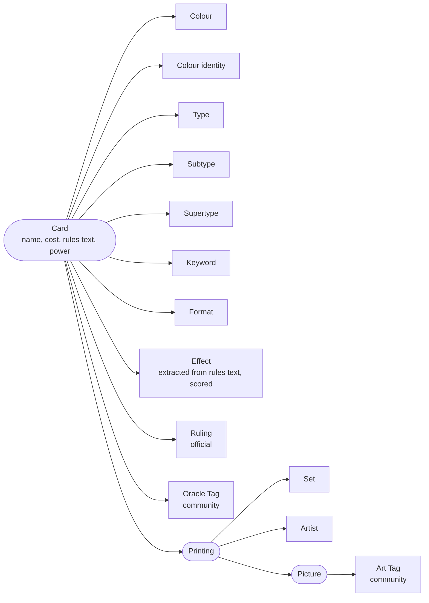
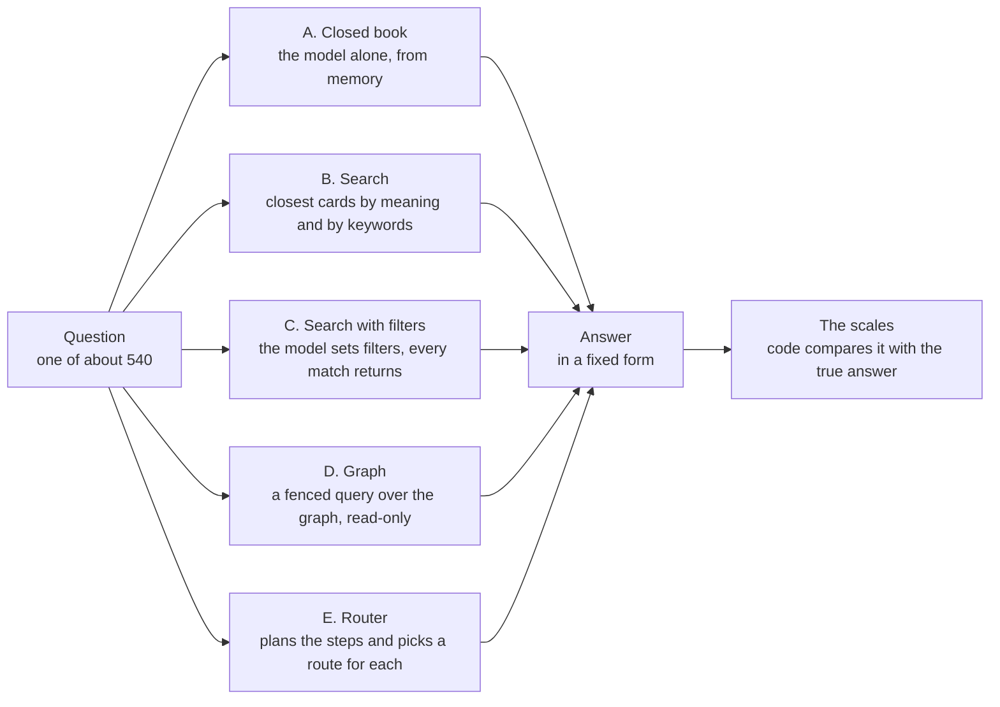

# 🃏 TopDeck: blueprint

**Questions about Magic: The Gathering cards, answered five ways, with every answer scored by code.**

Written 2026-11-20, before any code. This is the plan the repo is built against. When the plan changes, this file changes with it.

## The idea

TopDeck answers questions about Magic: The Gathering cards five ways, from a model's bare memory up to a knowledge graph, and measures what each step up buys and what it costs.

Most assistants today search by meaning: they fetch the few passages that sound most like the question, then answer from those. That works for "what does Counterspell do?". It fails for "how many red Goblins cost two mana or less?", because counting needs every matching card, not the five that sound closest.

A knowledge graph stores each fact as a link: this card is red, this card is a Goblin, this card was printed in that set. A query over those links can count, filter and hop from fact to fact, and return an exact answer.

That a database can count and a top-five search can't is known before the first run, so it is not the finding. **The open questions are these:**

- How often does a model write the right query, and how often is it wrong while sounding sure?
- How much does the wording of a question move the answer?
- How much of the graph's gain can plain filters already reach?
- Does knowledge pulled out of rules text help, or mislead?
- What does each answer cost?

Code checks nearly every answer against a true answer that a query can prove. The few that need my judgement are labelled blind and marked as such.

I started TopDeck in 2024 as a notebook that asked three questions about the cards and stopped before answering them. This rebuild answers those three first, then builds the system.

## Why this build

TopDeck shows four skills none of my other projects show yet, and it reuses the scoring from The Disease Division, my project that attacks and defends a search-based assistant.

| What TopDeck shows | Where my other projects stop |
| --- | --- |
| Answers from a knowledge graph, compared with search on the same questions | The Disease Division searches by meaning and by keywords only |
| A model that writes database queries, fenced in so it can only read | No project lets a model run a tool yet |
| Facts pulled out of free text, scored against labels I write by hand | Nothing yet |
| Telling apart what a model remembers from what it looked up | The Disease Division avoids the problem with a made-up airline; here I test it |

**Where the idea comes from.** A September 2024 paper from Ant Group and Zhejiang University calls it Knowledge Augmented Generation, or KAG ([arXiv 2409.13731](https://arxiv.org/abs/2409.13731)). Its abstract reports its method scoring 19.6% and 33.5% higher than earlier methods on two public tests of multi-step questions.

TopDeck is inspired by that paper and is not a copy of it. I take three of its ideas: a graph laid out so a model can read it, a link from every fact back to its source text, and questions broken into steps. I build them by hand so that I can measure each part and explain it. The paper's own framework runs as a separate stack of services under Docker Compose, by [its README](https://github.com/OpenSPG/KAG).

**How this differs from a model writing SQL.** At its core the graph route is a model writing queries over tables, and I'd rather say so than have a reader point it out. Three things are added: every link carries its source, some links are knowledge extracted from text with a measured error rate, and a router decides when the graph is the wrong tool.

## The cards

The cards come from Scryfall's free bulk files, downloaded once, pinned by date and fingerprint, and never committed to the repo.

| File | What it holds | What I use it for | Measured on 2026-11-21 |
| --- | --- | --- | --- |
| Oracle Cards | One entry per unique card, with its current rules text | The graph's cards, colours, types and rules text | 39,356 entries; 25.5 MB packed, 211.5 MB unpacked |
| Default Cards | One entry per printing of every card, in English where it exists | Artists, sets and first-printing dates, which belong to a printing and not to a card | 120,211 printings in 1,069 sets by 2,626 artists; 81.3 MB packed, 657.2 MB unpacked |

Three more files were pinned a day later, on 2026-11-22:

| File | What it holds | What I use it for | Measured on 2026-11-22 |
| --- | --- | --- | --- |
| Rulings | Official rulings on how cards work, each tied to its card | Rules questions, answered with the ruling they rest on | 80,928 rulings, 69 of them written by Scryfall's staff; 5.5 MB packed |
| Oracle Tags | Community labels on what cards do, from Scryfall Tagger | A second opinion beside my effect labels, never the answer key | 4,607 tags used 241,236 times; 6.1 MB packed |
| Art Tags | Community labels on what each picture shows, from Scryfall Tagger | A search aid for some art questions, never their answer key | 11,863 tags used 512,162 times; 13.5 MB packed |

All five are gzipped JSON Lines files: one card, printing, ruling or tag to a line, compressed. I read them as a stream, so nothing has to be unpacked to disk.

**Rulings join the core plan** (decided 2026-11-22). Scryfall's Rulings file holds the official rulings on how cards work, each tied to its card. It is pinned like the card files, loaded into the graph in Phase 1, and searched beside the rules text from Phase 3, so a rules question can be answered with the ruling it rests on. Many of the questions I care about most are rules questions, which is why it moved up from a stretch goal.

**What counts as a card.** The file holds more than playable cards: Scryfall says every card type in every product is in there, tokens and joke cards included, and a Goblin token would change every Goblin count. Task T1 wrote the rule, and every count in the project follows it. A card counts when it is a card (not an art card, a token, an emblem, a plane, a scheme or a vanguard), when at least one of its printings is on paper in an ordinary set, and when the Vintage format knows it. That keeps 32,495 of the 39,356 entries; the README lists what is left out and why.

**The awkward shapes.** Three, each with its own tests:

- A card's types arrive as one line of text that has to be split into supertype, type and subtype.
- Two-faced cards keep their colours, types and text on each face, not on the card. A card is its front face; a split card is both halves. Keywords are the one exception: Scryfall gives them for the whole card, so they stay on the card, and their source says all faces.
- Power is text, not a number (219 of the cards kept have a power such as `*`), so "highest power" counts whole numbers only.

**The rules I follow.** Scryfall's API page bars charging for access to its data and bars simply republishing it; software must add something for its users. TopDeck is free and adds answers, scores and a graph. It downloads a bulk file and never crawls the live API. It uses no card images, and it names itself in every request, as Scryfall asks. Scryfall lists research and Magic software among the things its data is for.

**Wizards of the Coast's Fan Content Policy** allows free fan projects that carry a notice saying the work is unofficial, is not approved or endorsed by Wizards, and uses materials that belong to Wizards. The README carries that notice, copied from the live policy page.

**The pin, and its limit.** The download command records each file's SHA-256 fingerprint and refuses any file that doesn't match. Scryfall rebuilds the bulk files every 12 to 24 hours and each file's address changes daily, so I assume a stranger can't download my exact file. The repo therefore keeps the count drawn from my snapshot and one fingerprint over the ids of every card kept.

**For tests,** the repo holds a small set of cards I invented, written in the shape of Scryfall's entries. The test suite runs in under a second with no download, and no real card text sits in the tests.

I first wrote this section from search results and memory, then checked it against Scryfall's and Wizards' own pages on 2026-11-21. The notice in the README matches the policy word for word.

## The graph

Every card links to thirteen kinds of fact: ten directly, two through its printings and one through their pictures. Every link remembers where it came from.

Set and Artist hang off a printing, not the card itself: one card can be printed many times, by different artists.

**Given links** come from Scryfall's own fields. Some arrive ready to use, such as colours, keywords and the formats a card is legal in. Types, subtypes and supertypes have to be split out of one line of text, so they are as right as my parser, and the parser has tests. Keywords are given for the whole card, not for each face, so a keyword only a card's back face has is still linked to the card, with the source `oracle_cards.keywords (all faces)`. Two columns are derived rather than given: each card's first printing date and each set's earliest printing in the graph.

**Community links** come from Scryfall Tagger, where volunteers label what a card does (Oracle Tags) and what its picture shows (Art Tags). Wizards does not check them, and I have not found how Scryfall reviews them. Their method is `community`, and they are kept apart from the given links. Rulings are official, method `given`, except the few Scryfall's own staff wrote, which are marked `scryfall`.

**No tag, checked or not, is ever the answer key for any score.** A template's true answer comes from its proving query over the given links only, and the golden questions and their answers live in a database of their own (both are set out below). The same holds for the chosen 108 and for any question about art: its true answer comes from my blind labels, or it is scored as one a system can't answer, and it is never read from the community tables. A tag may help a system find cards, and that is all.

**The check of 50 art tags** measures how often Tagger is right and reports that number; it does not promote any tag. The 50 are drawn by a fixed hash, spread across Tagger's own weights: 5 weak, 35 median, 5 strong and 5 very strong. The weight is Tagger's grading of each label, and the notes on the labels suggest it says how prominent the thing is in the picture. I set the bar before I mark: at least 90% right, weighted by how many links of each weight the graph holds, the same bar as for extracted links. Nearly every art-tag link is median, so that overall share rests almost wholly on the 35 median labels: it is worth about 37 labels, it carries a Wilson interval at that size, and it clears the bar only if at most 3 of those 35 are wrong. With 5 labels each, the other weights can show a weight that is mostly wrong, but not whether Tagger's weights mean anything. Oracle Tags are not checked: they serve only as a second opinion beside my effect labels.

I mark each label by rules written before the first one, as for the effects below:

- I judge the picture only, on the printing's Scryfall page and the face the table names: not the card's name, type line, rules text, set or frame.
- **Right:** what the tag names can be seen in the picture. How prominent it is does not matter: the weight is Tagger's, and I do not judge it.
- **Wrong:** it can't be seen, or what is there is something else.
- **Can't tell:** the picture alone can't show it, such as a plane or a place, how the art was made, what the card does, or words; or the picture is too small or dark to say. These are counted and reported, and left out of every share right.

The draw was first recorded as 10 weak, 20 median, 10 strong and 10 very strong. On 2026-11-26, before any label was marked, I moved it to 5, 35, 5 and 5, so the overall would rest on more labels, and I accepted the rules above as written. The seed is unchanged, so the new 50 keep the first 20 median labels and the first 5 of each other weight from the old draw. From here the draw, the bar and the rules are fixed.

`topdeck tags sample --table` writes the 50 as a table to mark, with the notes volunteers wrote on some labels; it goes in `marking/`, which Git ignores. `topdeck tags score --table` reads my marks back, checks each row is still the label drawn under its number, and records the verdicts in `results/art_tag_verdicts.json`, keyed by picture and tag, with no notes.

**Extracted links** come from the rules text: what a card does. "Draw two cards" becomes a link from the card to the effect *draws cards*. I fix a closed list of twelve effects first, each with a written rule for the hard cases: who draws, and whether "discard a card" is a price the player pays or something done to an opponent.

Extraction then runs in two stages:

1. Patterns I write by hand catch the plain cases.
2. A model reads the rules text the patterns missed and proposes links.

**The labels that judge it.** A random sample would hold too few examples of each effect to measure anything. So for each effect I gather 30 cards that have it and 30 near misses, up to 720 judgements in all. Half are for tuning the patterns and half are held back.

**The bar.** An effect's links join the graph only if at least 90% of a fresh sample of 50 of them are right. How many true cases each effect misses is reported and not gated. An effect that can't reach the bar stays out, and the README says so.

I am the only labeller. To measure how steady I am, I label 50 of the cards again a week later and report how often I agree with myself.

**Every link carries its source:** the card, the field or the exact words in the rules text, and the method that produced it. That is what lets an answer cite its evidence, and what lets me trace a wrong answer back to one bad link.

**Where it lives:** PostgreSQL, as one table per kind of thing and one table per kind of link. Morning Manna, my Bible reading app, and The Disease Division already run on it. This graph is shallow, with most questions one to three steps deep, and Postgres handles deeper walks with recursive queries. A dedicated graph database is a stretch goal, taken only if a measured question type needs it.

## The questions

The golden set (the questions with known true answers that every system is scored on) holds about 540 questions in nine types. Six types have answers a query can prove; the rest need my own labels, and I say which.

| Type | Example | What it tests | My prediction |
| --- | --- | --- | --- |
| Lookup | What does Counterspell do? | One card's text | Any system that looks it up |
| Filter | Which blue creatures with flying cost exactly two mana? | Every match and no extras | Filters or the graph |
| Count | How many red Goblins cost two mana or less? | An exact number over all cards | Filters or the graph |
| Best of | Which green creature with trample has the highest power for four mana or less? | Sorting over every match | The graph |
| Multi-step | Which artists have illustrated both a legendary Elf and a legendary Goblin? | Walking from fact to fact | The graph |
| None | A Filter question with one condition changed so that nothing matches | Saying "none" for the right reason | Filters or the graph |
| Meaning | Which cards punish an opponent for drawing extra cards? | What the rules text means | Search |
| Mixed | Which black cards that force a discard are legal in Pauper? | Meaning and structure together | The router |
| Out of scope | What is this card worth today? | Saying "I can't answer that" | Any system that says so |

The predictions are written before any run. The results will sit beside them, and a wrong prediction stays in the README.

**Five sources, so no score rests on one kind of wording:**

- **288 from templates.** Each of the six provable types gets 12 templates, and each template is filled in 4 ways. A template comes with a query I write and test by hand, over the given links only; its result is the true answer. Answers longer than 25 cards are asked as counts.
- **40 on meaning,** 20 Meaning and 20 Mixed. No query can prove these, and using my own extracted links as the truth would let the graph mark its own homework. So I write a definition for each question, then label by hand every card any system returns for it, without seeing which system returned it. Search engines are judged the same way.
- **108 chosen by me in Phase 0,** before the graph had a layout, so the layout can't shape them. Model helpers that never saw the layout drafted them; I rated every draft and kept the ones I rated highest. They live in [`questions/chosen.md`](../questions/chosen.md).
- **80 paraphrases** of template questions, to measure how much the wording alone moves the score.
- **20 out of scope:** prices, deck advice, and how two cards interact where no ruling covers it.

**Why the chosen 108 look the way they do.** I want TopDeck to be mainly about questions a web search can't easily answer. The drafts I rated highest share three things: they need judgement or a story (rules interactions, advice on a deck, "what happened to" and "why"); they turn on art, artists and flavour text with a twist; or they ask whether anything like this exists in an odd corner. Many can't be answered from card data at all, such as what is painted in a picture or what to cut from a deck. For those, a system scores by saying it can't answer, or by answering with a source a reader can check. How each of the 108 is scored is set in Phase 2, question by question.

**Every word is pinned.** Each template states what its words mean: "red" means red is among the card's colours, and "legal" means legal, not banned or restricted.

**"None" has a twin.** A broken query also returns nothing, and would be marked right by luck. So every None question is paired with its Filter original, and "none" only scores when the twin is right too.

**The split.** Half the templates are for tuning and half are held back, balanced by type, and opened once for the final table. Every filling and every paraphrase of a template stays on the same side as its template, so nothing learned in tuning can leak across.

**The cells are small, and I say so now.** Each type has about 24 held-back template questions from 6 templates. A score on 24 questions is only good to within about 18 points either way, so only large gaps will be called.

**Memory against look-up, tested two ways.** First, twin questions: one about cards first printed at least six months after the model's training cut-off, one about older cards. Second, 30 cards I invent, which no model can have seen, added to a copy of the store for this test alone. Newer cards differ from older ones in more than date, so these results suggest and don't prove.

**The 2024 questions come first.** Are Elves green and Goblins red? Do some artists appear far more than others? Which subtypes hide inside which colours? Phase 1 answers all three with counts and with lift (how many times more often a pairing appears than chance would give), each with its interval.

## The contenders

Five systems answer the same questions, each one step up from the last, so every gain is measured against something simpler.

The graph route is the one under test; the other four exist to show what it adds and what it costs.

| Contender | How it answers | Where I expect it to fail |
| --- | --- | --- |
| A. Closed book | The model alone, from memory | Newer cards, counts, anything exact |
| B. Search | Finds the closest cards by meaning and by keywords, then answers from those | Counts, filters and multi-step questions, where the answer needs every match |
| C. Search with filters | The model also sets filters on the given fields (colour, type, cost), and every match comes back | Sorting, and any question that walks from one kind of thing to another |
| D. Graph | The model reads the graph's layout, writes a query, and words the rows that come back | Questions about meaning, and any question it turns into the wrong query |
| E. Router | Reads the question, plans the steps, and picks a route for each | The plan itself: one wrong step spoils the answer |

**Contender C keeps D honest.** If filters reach the same score on a question type, the graph bought nothing there, and the grid will show it.

**The same terms for all five.** One model version, the same settings, and the same number of prompt revisions each, with every revision logged.

**The fence around contender D.** A model that writes queries is a model holding a tool, so I treat what it writes as untrusted, the lesson The Disease Division is built on:

- Its database login sees one set of read-only views and nothing else. The golden questions and their true answers live in a different database.
- Code parses each query and allows only listed parts: one SELECT, with or without a recursive step, and only functions on an allow-list. Writes, locks and sleeps are not on it.
- The time limit and the read-only setting sit on the login itself, where a query can't change them.
- A result cut short by the row limit counts as a failure, never as a silent short answer.
- When a query fails, the model gets one try at fixing it, with the error message.
- Every query is logged beside the answer it produced.
- A test suite attacks the fence with each escape I know of, and CI runs it.
- No prompt ever shows an example taken from the held-back templates.

In the live demo, a visitor's question and the card text handed back to the model are both treated as untrusted too.

**The plan is kept.** For a multi-step question the router writes its steps down before it acts, and each step's query and result is stored. A wrong answer can then be traced to the step that broke. The router's choice of route is scored against the route each question was built for.

## The scales

The headline is one grid, question type by contender, and not one overall number: an average would hide the very thing this project measures.

**Answers come in a fixed form.** Every contender must reply with a list of card ids, a number, "none" or "out of scope", plus one word: sure or unsure. Code reads that form and never has to dig a card name out of a sentence.

| Measure | How code checks it |
| --- | --- |
| Card lists | Of the cards named, the share that are right (precision); of the right cards, the share that were named (recall); and F1, one number that joins the two |
| Counts and numbers | Exact match, and how far off when wrong |
| Lookup | The quoted rules text matches the stored text letter for letter, and so do cost and type |
| Empty answers | A correct "none" counts only when its twin question is right too; cards invented where none exist are counted |
| Out of scope | Said so, or answered anyway |
| Right query | The rows the model's query returns equal the true rows. This separates a wrong query from a right query worded badly |
| Queries that run | The share that run first time, the share fixed on the retry, the share that never run |
| Confidently wrong | A wrong answer marked "sure": the failure that does the most harm |
| Citations | Every card id named exists, and every link cited is among the rows that came back |
| Route | The router's choice against the route each question was built for |
| Wording | The score on paraphrases beside the score on their originals |
| Extraction | Each effect's share right, and share found, against my held-back labels |
| Cost and speed | Cost per answer, and the typical and the slow response time |

Meaning questions are the exception: their true set is my blind labels, so their recall is measured within the labelled cards.

**The statistics, decided now.**

- Each cell of the grid carries a Wilson interval, which stays honest at 0% and 100%.
- Contenders are compared on the same questions by resampling whole templates, because four fillings of one template rise and fall together.
- Six comparisons get a verdict, and I name them here: B against C, C against D and D against E overall; C against D on multi-step questions; D before and after extraction on mixed questions; and D on originals against paraphrases. Everything else is description.
- The model runs at its steadiest setting and every output is stored. Fifty questions run three times, to measure how much the answers wobble on their own.

I also keep every failed question in a browsable list, sorted by cause: wrong query, missing link, bad plan, or wording the system misread. That list decides what gets fixed next.

## Stack and cost

TopDeck adds no new infrastructure: it runs on the stack Morning Manna and The Disease Division already use, on a laptop with no graphics card.

| Part | Tool |
| --- | --- |
| Language and tooling | Python 3.12, uv with a lock file, ruff, pytest, GitHub Actions |
| Store | PostgreSQL with pgvector (its add-on for search by meaning), in Docker |
| Search by meaning | FastEmbed, on the processor |
| Query checking | A SQL parser library, chosen in Phase 4 |
| Query writing and answers | Claude, through its API |
| Serving | FastAPI, in Docker |

**The key stays home.** The API key lives in a local file that Git ignores. Tests and CI (the checks GitHub runs on every push) use a stand-in client with recorded replies, so they need no key and spend nothing.

**Every run leaves a record.** The results file names the model version, its settings and a fingerprint of each prompt. Every model output and every per-question score is committed, so anyone can rebuild the grid offline and for free.

**Four costs are unknown until measured, and each has a guard:**

- **Answering.** Phase 3 measures the cost per answer on 20 questions before any full run. The run script carries a hard spending cap and stops when it is reached.
- **Extraction.** Reading tens of thousands of rules texts with a model is likely the largest bill. It is priced on 500 cards first, and I decide then how much of the pass to run.
- **Disk.** The card files, the database and the embedding model each get their installed size quoted before anything downloads.
- **Time to embed every card.** Measured on 1,000 cards first, then scaled.

## Phases and tasks

Nine phases, twelve tasks, and each phase ends on a proof that one command can repeat.

| Phase | What it ships | The proof it's done | Tasks |
| --- | --- | --- | --- |
| 0. Ground | This blueprint in the repo, tooling, CI, the 2024 notebook moved aside unchanged, the data policies read, and my 108 chosen questions | CI green on an empty package | T0 |
| 1. The cards | The rule for what counts as a card, the pinned download, the parser, the cards in Postgres, every given link, the rulings and the community tags, the 2024 questions answered, and my check of 50 art tags | Card and link counts reproduce from one command, and so does the score of my 50 art-tag verdicts | T1, T2, T3 |
| 2. The questions | Templates with their proving queries, paraphrases, the out-of-scope set, the split | Every true answer is rebuilt by its query, and a test checks it | T4 |
| 3. Search | Contenders A, B and C, searching the card text and the official rulings | The grid's first three rows, with intervals | T5 |
| 4. The graph route | Contender D with its fence | The grid's fourth row; the fence's attack tests pass | T6, T7 |
| 5. Extraction | The twelve effects and their rules, my labels, the patterns, the model pass, the new links | Each effect's score against held-back labels; the grid re-scored | T8 |
| 6. The router | Contender E with its stored plans, and the memory tests | The held-back questions opened once; the final grid | T9 |
| 7. Serving | The API, the Docker image, a small page to ask questions | The image builds from clean and answers the README's example | T10 |
| 8. The telling | The README, charts for light and dark screens (the first five landed in Phase 1), the failure list, the project page | Every number rebuilds from the stored outputs; a fresh run lands inside the intervals | T11 |

**Stretch goals, each taken only if the phase before it lands clean:**

- **A cost curve.** Run contender D's query writing on a small and a large model, on the tuning half only, and plot accuracy against cost per answer.
- **A live demo** on a free host, with a rate limit and the spending cap.
- **A graph database beside Postgres,** only if the grid shows a question type that Postgres answers badly.

## What happens to the 2024 notebook

The 2024 code stays in the repo unchanged, in `notebooks/2024-original/`, with a test that fails if a single byte of it moves.

It is 76 lines: it loads a CSV from my Google Drive, drops duplicate card names, prints four counts (artists, colour identity, type, subtype) and drops 17 columns. Its last line is a note to myself to tidy the cleaning into a function. None of its three questions gets an answer.

Reading it again in 2026, I found three things the rebuild corrects:

| 2024 | Why it matters | 2026 |
| --- | --- | --- |
| The CSV's source isn't recorded | Nobody else can rerun it, me included | A named source, a date and a fingerprint |
| Duplicate names are dropped before artists are counted | If the file holds one row per printing, as the repeated names suggest, a card printed five times with five artists keeps one, and the artist counts are wrong | Artists are counted per printing |
| Counts only | A count can't say whether Elves are green more than chance would make them | Counts with lift (how many times more often than chance) and its interval |

The README will show 2024 beside 2026 plainly, as the churn README does. Where I began is part of the story.

## Limits, and what is still unchecked

TopDeck measures graph answers on a clean, shallow graph of game cards; it does not prove the same gains on messy company documents.

**Limits I know now:**

- **Part of the result is known in advance.** A database can count and a top-five search can't. Contender C is there so the graph gets no credit for what plain filters already do, and the open questions are the ones listed under The idea.
- **The cells are small.** About 24 held-back questions per type, from 6 templates, means only large gaps can be called.
- **One labeller.** Every hand label is mine. I measure how often I agree with myself; nobody else checks me.
- **Models have read about Magic.** The closed-book contender, the newer-cards twins and the invented cards test that memory; they can't remove it.
- **The graph is shallow and mostly given.** Scryfall's fields are already structured, so only the effects test extraction. The KAG paper's tests need deeper steps over plain documents.
- **Template questions are tidier than real ones.** The chosen set and the paraphrases measure the gap.
- **A stranger can't fetch my exact card file.** They can rebuild every number from the stored outputs, and rerun on a newer file with the changes reported.
- **TopDeck doesn't work out new rulings.** It answers a rules question only where an official ruling covers it, and cites that ruling; anything further is out of scope.
- **English cards, as of one pinned date.**

**Checked against the pages themselves on 2026-11-21:**

- **Scryfall's rules and files.** The rules are as described above. The files are gzipped JSON Lines, rebuilt every 12 to 24 hours.
- **The shape of the data.** Scryfall's Cards page confirms it: the type line is one string, two-faced cards keep their fields on each face, power is text, and legality has four values (legal, not legal, restricted, banned).
- **Wizards' Fan Content Policy,** last updated November 15, 2017. The notice is copied word for word.
- **The KAG paper.** Its title, its two numbers, its five ideas and its authors' affiliations are as stated.

**Still open:**

- [ ] Whether an old bulk file can still be fetched once its address has changed.
- [ ] Whether card text may sit in a public repo inside the golden questions and the failure list. The policy allows free fan content that uses Wizards' text, and doesn't speak of test data. I read that as yes, with the notice; it is my reading, not a ruling. The tests avoid the question by using invented cards.
- [ ] The policy asks that fan content be free for others to use without giving credit, and the MIT licence asks that its notice be kept. I read the licence as covering my code and the policy as covering Wizards' material. Nobody has checked that reading.
- [ ] The policy bars a list of logos, shown as pictures. By their file names they are the Magic and Arena logos, the planeswalker symbol and the mana symbols. TopDeck writes costs as text and uses no logo; I have yet to look at the pictures themselves.
- [ ] Oracle Tags, where Scryfall's community labels what cards do, and Art Tags, where it labels what is in each picture. Both are now in the graph as community links, kept apart from the official ones. The first could be a second opinion on my effect labels; the second could help a system find cards for my art questions. Neither ever grades an answer. I check a fixed sample of 50 art tags by eye to measure how often Tagger is right.
- [ ] Tagger's own pages: how it reviews volunteers' edits, and the terms its data comes under. I have not read them yet.

## Decisions before the first task

Seven choices were mine to make before task T0; my recommendation is beside each, and a tick marks a choice made.

- [x] **Approve this blueprint.** Approved 2026-11-20.
- [ ] **Rebuild in place or start a new repo?** In place, in TopDeck-MTG, with the history kept, as I did for the churn project.
- [ ] **Include every printing from the start?** Yes, once its size is known: the artist question and the first-printing dates can't be answered without printings.
- [ ] **How much hand labelling?** As planned: up to 720 effect judgements, the labels for 40 meaning questions, and the choice of 108 questions, which is done. It is the largest hand job in the project and the part no tool can do for me.
- [ ] **Which model answers?** The one The Disease Division settles on, so the two projects share one client and one cost record.
- [x] **Where it sits in the queue.** Phases 0 to 2 began on 2026-11-20: they need nothing from my other projects. Phase 3 reuses The Disease Division's search and scoring, so it waits for those. A LoRA fine-tune, my first PyTorch build, follows TopDeck.
- [ ] **Read the policy pages by eye,** and settle the six boxes still open in the section above.

## Words used here

| Word | What it means |
| --- | --- |
| Golden set | The questions with known true answers that every system is scored on |
| Template | A question with blanks, such as "how many \[colour\] \[subtype\]s cost \[number\] or less?", filled in several ways |
| Held back | Questions no system is tuned on, opened once for the final scores |
| Precision, recall, F1 | Of what was named, the share that is right; of what is right, the share that was named; one number joining the two |
| Interval | The range a score would likely fall in if the questions were drawn again |
| Link | One stored fact joining two things, such as a card and its colour |
| Fence | The limits that stop a model-written query from doing anything but read |
| Fixture | A small sample of data kept in the repo for tests |
| CI | The checks GitHub runs on every push |
| RAG | Answering from passages found by search |

## Sources

- [KAG: Boosting LLMs in Professional Domains via Knowledge Augmented Generation](https://arxiv.org/abs/2409.13731), arXiv 2409.13731 (opened 2026-11-21)
- [OpenSPG/KAG README](https://github.com/OpenSPG/KAG) (opened 2026-11-20)
- [Scryfall API documentation](https://scryfall.com/docs/api), [bulk data files](https://scryfall.com/docs/api/bulk-data), [card objects](https://scryfall.com/docs/api/cards) (opened 2026-11-21)
- [Wizards of the Coast Fan Content Policy](https://company.wizards.com/en/legal/fancontentpolicy) (opened 2026-11-21)
- The 2024 TopDeck script in [my repo](https://github.com/OGobidike/TopDeck-MTG) (read in full)
